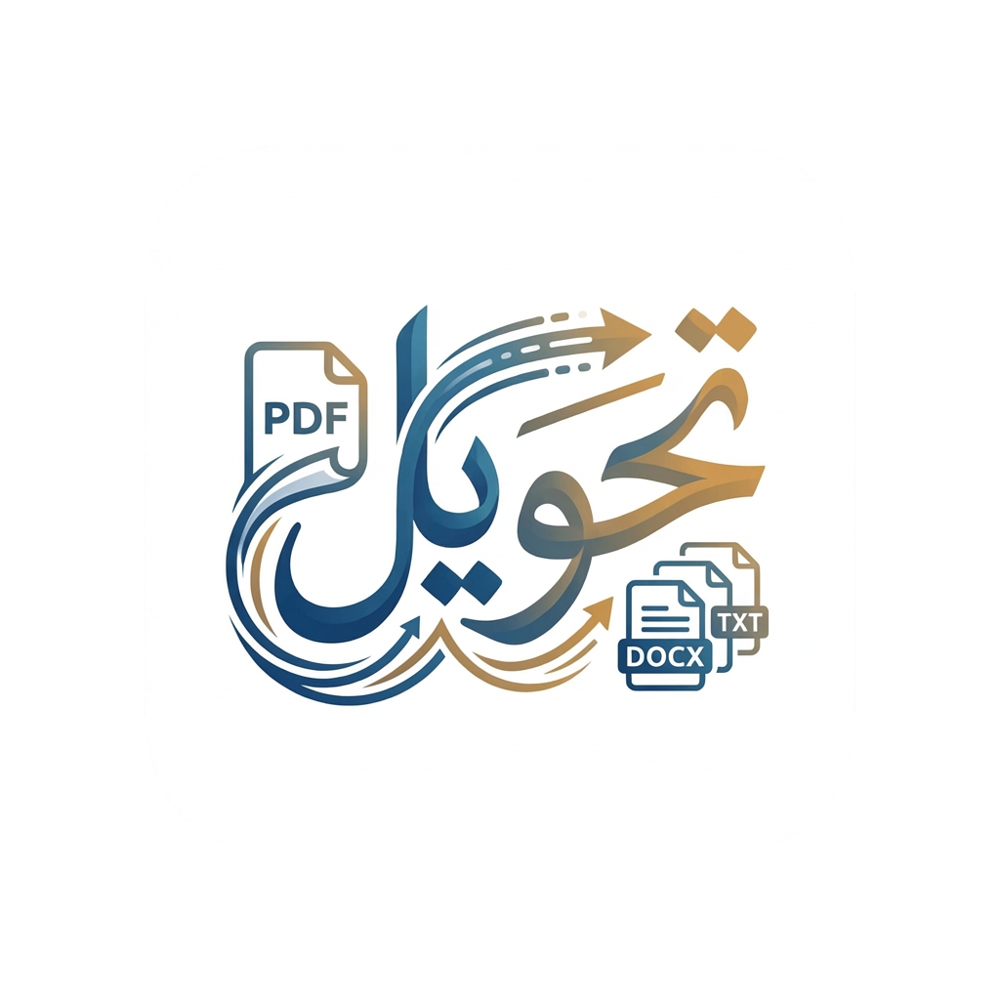

  

<h1 dir="rtl" align="center">موقع تحويل (Tahweel Website)</h1>

  <strong>الموقع الرسمي لمشروع تحويل — أداة تحويل ملفات PDF والصور إلى نصوص</strong>

  <a href="README.en.md">🌐 English</a>

---

يحتوي هذا المستودع على الموقع الرسمي لمشروع <strong>تحويل</strong>. الموقع عبارة عن صفحة ثابتة (HTML و CSS و JavaScript) تُستضاف على Netlify، تعرض المميزات وتوفر روابط تحميل أحدث إصدارات تطبيق سطح المكتب مباشرةً من GitHub.

<h2 dir="rtl">المشاريع ذات الصلة</h2>

<ul dir="rtl">
  <li>🐍 <a href="https://github.com/ieasybooks/tahweel">ieasybooks/tahweel</a> — النسخة الأصلية المكتوبة بلغة Python</li>
  <li>💎 <a href="https://github.com/ieasybooks/tahweel.rb">ieasybooks/tahweel.rb</a> — مكتبة Ruby وواجهة سطر الأوامر</li>
  <li>🖥️ <a href="https://github.com/ieasybooks/tahweel-tauri">ieasybooks/tahweel-tauri</a> — تطبيق سطح المكتب المبني باستخدام Tauri</li>
</ul>

<h2 dir="rtl">الرخصة</h2>

هذا الموقع متاح كمصدر مفتوح بموجب شروط <a href="https://opensource.org/licenses/MIT">رخصة MIT</a>.

---

صُنع بـ ❤️ بواسطة <a href="https://github.com/ieasybooks">iEasyBooks</a>

